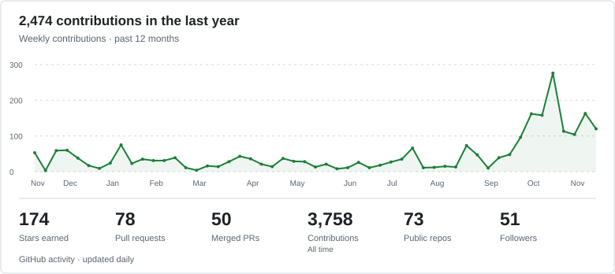

<!-- Typing SVG -->

  <picture>
    <source media="(prefers-color-scheme: dark)" srcset="https://raw.githubusercontent.com/wrestle-R/wrestle-R/output/github-snake-dark.svg" />
    
  </picture>

<strong>Russel and his agents against the rest of the world</strong>

---

### A little about me

I build things for the web, my Linux desktop, and whatever else I get curious about. Some turn into proper projects, some give me something to write about.

### What I'm working on

I've gotten really into widgets lately. A lot of what I'm building now lives on my phone's home screen or my Linux desktop.

- [Pingora](https://github.com/wrestle-R/Pingora) connects my Android phone and Linux laptop. Notifications, clipboard, files and home screen widgets.
- [Task-tick](https://github.com/wrestle-R/Task-tick) puts my todos and watchlist in Android widgets, with offline lists and sync. [Try it](https://task-tick-beige.vercel.app/app).
- [Widgets](https://github.com/wrestle-R/widgets) is where I'm making more of them. App Unlocks has five designs for counting phone unlocks. [Try the resizable previews](https://widgets-gules-nu.vercel.app/).
- [LogIt](https://github.com/wrestle-R/LogIt) is a tracker with widgets, inspired by BigRom's LogIt.

The tools I'm building around all of this

- [MultiCodex](https://github.com/wrestle-R/multi-codex) manages Codex accounts across the desktop app, VS Code and CLI.
- [Vathavaran / Varte](https://github.com/wrestle-R/Vathavaran-Variables) keeps encrypted environment files across terminal, web and mobile.
- [ArchJet](https://github.com/wrestle-R/ArchJet) is a local printer workspace for Arch Linux and Hyprland.
- [The Mbappe Special](https://github.com/wrestle-R/Mbappe-Special) is the collection of agent skills I use and customise for how I work.

[My corner of the internet](https://russel.is-a.dev) · [My writing](https://blog.russel.is-a.dev)

**Usually working with** &nbsp; TypeScript · React · Python · Qt / QML · Linux

### Latest from the blog

<!-- LATEST-BLOG:START -->
<a href="https://blogs.russeldanielpaul.is-a.dev/blog/we-fell-in-code-in-october/">
<picture>
  <source media="(max-width: 480px) and (prefers-color-scheme: dark)" srcset="assets/generated/latest-blog-dark-mobile.svg" />
  <source media="(max-width: 480px)" srcset="assets/generated/latest-blog-light-mobile.svg" />
  <source media="(prefers-color-scheme: dark)" srcset="assets/generated/latest-blog-dark.svg" />
  
</picture>
</a>
<!-- LATEST-BLOG:END -->

### GitHub activity

<!-- ACCOUNT-STATS:START -->
<a href="https://github.com/wrestle-R">
<picture>
  <source media="(max-width: 480px) and (prefers-color-scheme: dark)" srcset="assets/generated/account-stats-dark-mobile.svg" />
  <source media="(max-width: 480px)" srcset="assets/generated/account-stats-light-mobile.svg" />
  <source media="(prefers-color-scheme: dark)" srcset="assets/generated/account-stats-dark.svg" />
  
</picture>
</a>

Contribution totals include public and private activity shared on my GitHub profile. The graph covers the past year; the all-time total covers every year since I joined GitHub.

Explore weekly contribution counts

Select a date range to open that week on GitHub. The first and current weeks may be partial.

| Date range | Contributions |
| --- | ---: |
| [2026-11-15 to 2026-11-20](https://github.com/wrestle-R?tab=overview&from=2026-11-15&to=2026-11-20) | 137 |
| [2026-11-08 to 2026-11-14](https://github.com/wrestle-R?tab=overview&from=2026-11-08&to=2026-11-14) | 163 |
| [2026-11-01 to 2026-11-07](https://github.com/wrestle-R?tab=overview&from=2026-11-01&to=2026-11-07) | 104 |
| [2026-10-25 to 2026-10-31](https://github.com/wrestle-R?tab=overview&from=2026-10-25&to=2026-10-31) | 113 |
| [2026-10-18 to 2026-10-24](https://github.com/wrestle-R?tab=overview&from=2026-10-18&to=2026-10-24) | 276 |
| [2026-10-11 to 2026-10-17](https://github.com/wrestle-R?tab=overview&from=2026-10-11&to=2026-10-17) | 158 |
| [2026-10-04 to 2026-10-10](https://github.com/wrestle-R?tab=overview&from=2026-10-04&to=2026-10-10) | 162 |
| [2026-09-27 to 2026-10-03](https://github.com/wrestle-R?tab=overview&from=2026-09-27&to=2026-10-03) | 96 |
| [2026-09-20 to 2026-09-26](https://github.com/wrestle-R?tab=overview&from=2026-09-20&to=2026-09-26) | 48 |
| [2026-09-13 to 2026-09-19](https://github.com/wrestle-R?tab=overview&from=2026-09-13&to=2026-09-19) | 39 |
| [2026-09-06 to 2026-09-12](https://github.com/wrestle-R?tab=overview&from=2026-09-06&to=2026-09-12) | 10 |
| [2026-08-30 to 2026-09-05](https://github.com/wrestle-R?tab=overview&from=2026-08-30&to=2026-09-05) | 47 |
| [2026-08-23 to 2026-08-29](https://github.com/wrestle-R?tab=overview&from=2026-08-23&to=2026-08-29) | 73 |
| [2026-08-16 to 2026-08-22](https://github.com/wrestle-R?tab=overview&from=2026-08-16&to=2026-08-22) | 13 |
| [2026-08-09 to 2026-08-15](https://github.com/wrestle-R?tab=overview&from=2026-08-09&to=2026-08-15) | 15 |
| [2026-08-02 to 2026-08-08](https://github.com/wrestle-R?tab=overview&from=2026-08-02&to=2026-08-08) | 12 |
| [2026-07-26 to 2026-08-01](https://github.com/wrestle-R?tab=overview&from=2026-07-26&to=2026-08-01) | 11 |
| [2026-07-19 to 2026-07-25](https://github.com/wrestle-R?tab=overview&from=2026-07-19&to=2026-07-25) | 66 |
| [2026-07-12 to 2026-07-18](https://github.com/wrestle-R?tab=overview&from=2026-07-12&to=2026-07-18) | 35 |
| [2026-07-05 to 2026-07-11](https://github.com/wrestle-R?tab=overview&from=2026-07-05&to=2026-07-11) | 27 |
| [2026-06-28 to 2026-07-04](https://github.com/wrestle-R?tab=overview&from=2026-06-28&to=2026-07-04) | 18 |
| [2026-06-21 to 2026-06-27](https://github.com/wrestle-R?tab=overview&from=2026-06-21&to=2026-06-27) | 11 |
| [2026-06-14 to 2026-06-20](https://github.com/wrestle-R?tab=overview&from=2026-06-14&to=2026-06-20) | 26 |
| [2026-06-07 to 2026-06-13](https://github.com/wrestle-R?tab=overview&from=2026-06-07&to=2026-06-13) | 11 |
| [2026-05-31 to 2026-06-06](https://github.com/wrestle-R?tab=overview&from=2026-05-31&to=2026-06-06) | 8 |
| [2026-05-24 to 2026-05-30](https://github.com/wrestle-R?tab=overview&from=2026-05-24&to=2026-05-30) | 21 |
| [2026-05-17 to 2026-05-23](https://github.com/wrestle-R?tab=overview&from=2026-05-17&to=2026-05-23) | 13 |
| [2026-05-10 to 2026-05-16](https://github.com/wrestle-R?tab=overview&from=2026-05-10&to=2026-05-16) | 28 |
| [2026-05-03 to 2026-05-09](https://github.com/wrestle-R?tab=overview&from=2026-05-03&to=2026-05-09) | 29 |
| [2026-04-26 to 2026-05-02](https://github.com/wrestle-R?tab=overview&from=2026-04-26&to=2026-05-02) | 37 |
| [2026-04-19 to 2026-04-25](https://github.com/wrestle-R?tab=overview&from=2026-04-19&to=2026-04-25) | 14 |
| [2026-04-12 to 2026-04-18](https://github.com/wrestle-R?tab=overview&from=2026-04-12&to=2026-04-18) | 21 |
| [2026-04-05 to 2026-04-11](https://github.com/wrestle-R?tab=overview&from=2026-04-05&to=2026-04-11) | 36 |
| [2026-03-29 to 2026-04-04](https://github.com/wrestle-R?tab=overview&from=2026-03-29&to=2026-04-04) | 43 |
| [2026-03-22 to 2026-03-28](https://github.com/wrestle-R?tab=overview&from=2026-03-22&to=2026-03-28) | 28 |
| [2026-03-15 to 2026-03-21](https://github.com/wrestle-R?tab=overview&from=2026-03-15&to=2026-03-21) | 14 |
| [2026-03-08 to 2026-03-14](https://github.com/wrestle-R?tab=overview&from=2026-03-08&to=2026-03-14) | 16 |
| [2026-03-01 to 2026-03-07](https://github.com/wrestle-R?tab=overview&from=2026-03-01&to=2026-03-07) | 4 |
| [2026-02-22 to 2026-02-28](https://github.com/wrestle-R?tab=overview&from=2026-02-22&to=2026-02-28) | 11 |
| [2026-02-15 to 2026-02-21](https://github.com/wrestle-R?tab=overview&from=2026-02-15&to=2026-02-21) | 39 |
| [2026-02-08 to 2026-02-14](https://github.com/wrestle-R?tab=overview&from=2026-02-08&to=2026-02-14) | 31 |
| [2026-02-01 to 2026-02-07](https://github.com/wrestle-R?tab=overview&from=2026-02-01&to=2026-02-07) | 31 |
| [2026-01-25 to 2026-01-31](https://github.com/wrestle-R?tab=overview&from=2026-01-25&to=2026-01-31) | 35 |
| [2026-01-18 to 2026-01-24](https://github.com/wrestle-R?tab=overview&from=2026-01-18&to=2026-01-24) | 23 |
| [2026-01-11 to 2026-01-17](https://github.com/wrestle-R?tab=overview&from=2026-01-11&to=2026-01-17) | 75 |
| [2026-01-04 to 2026-01-10](https://github.com/wrestle-R?tab=overview&from=2026-01-04&to=2026-01-10) | 24 |
| [2025-12-28 to 2026-01-03](https://github.com/wrestle-R?tab=overview&from=2025-12-28&to=2026-01-03) | 9 |
| [2025-12-21 to 2025-12-27](https://github.com/wrestle-R?tab=overview&from=2025-12-21&to=2025-12-27) | 17 |
| [2025-12-14 to 2025-12-20](https://github.com/wrestle-R?tab=overview&from=2025-12-14&to=2025-12-20) | 38 |
| [2025-12-07 to 2025-12-13](https://github.com/wrestle-R?tab=overview&from=2025-12-07&to=2025-12-13) | 60 |
| [2025-11-30 to 2025-12-06](https://github.com/wrestle-R?tab=overview&from=2025-11-30&to=2025-12-06) | 59 |
| [2025-11-23 to 2025-11-29](https://github.com/wrestle-R?tab=overview&from=2025-11-23&to=2025-11-29) | 3 |
| [2025-11-16 to 2025-11-22](https://github.com/wrestle-R?tab=overview&from=2025-11-16&to=2025-11-22) | 53 |

<!-- ACCOUNT-STATS:END -->

---

   &nbsp;
  

