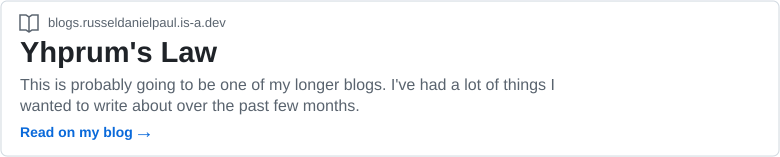
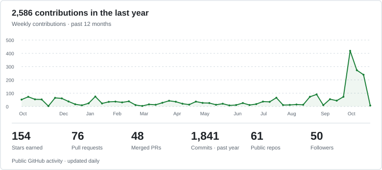

<!-- Typing SVG -->

  <picture>
    <source media="(prefers-color-scheme: dark)" srcset="https://raw.githubusercontent.com/wrestle-R/wrestle-R/output/github-snake-dark.svg" />
    
  </picture>

<strong>Russel and his agents against the rest of the world</strong>

---

### A little about me

I build things for the web, my Linux desktop, and whatever else I get curious about. Some turn into proper projects, some give me something to write about.

### Things I've been building

<table>
<tr>
<td width="50%" valign="top">
DEVELOPER TOOLS
<h3><a href="https://github.com/wrestle-R/multi-codex">MultiCodex ↗</a></h3>

Manage Codex accounts across the desktop app, VS Code, and CLI. Separate accounts, your default login stays yours.

</td>
<td width="50%" valign="top">
LINUX DESKTOP
<h3><a href="https://github.com/wrestle-R/ArchJet">ArchJet ↗</a></h3>

A local printer workspace for Linux, built for Arch and Hyprland.

</td>
</tr>
<tr>
<td width="50%" valign="top">
ENVIRONMENT FILES
<h3><a href="https://github.com/wrestle-R/Vathavaran-Variables">Vathavaran / Varte ↗</a></h3>

Encrypted environment files across terminal, web, and mobile.

</td>
<td width="50%" valign="top">
THE PERSONAL STUFF
<h3><a href="https://russeldanielpaul.is-a.dev">My corner of the internet ↗</a></h3>

Projects, writing, and the other things I want to put somewhere.

</td>
</tr>
</table>

**Usually working with** &nbsp; TypeScript · React · Python · Qt / QML · Linux

### Latest from the blog

<!-- LATEST-BLOG:START -->
<a href="https://blogs.russeldanielpaul.is-a.dev/blog/yhprums-law/">
<picture>
  <source media="(max-width: 480px) and (prefers-color-scheme: dark)" srcset="assets/generated/latest-blog-dark-mobile.svg" />
  <source media="(max-width: 480px)" srcset="assets/generated/latest-blog-light-mobile.svg" />
  <source media="(prefers-color-scheme: dark)" srcset="assets/generated/latest-blog-dark.svg" />
  
</picture>
</a>
<!-- LATEST-BLOG:END -->

### GitHub activity

<!-- ACCOUNT-STATS:START -->
<a href="https://github.com/wrestle-R">
<picture>
  <source media="(max-width: 480px) and (prefers-color-scheme: dark)" srcset="assets/generated/account-stats-dark-mobile.svg" />
  <source media="(max-width: 480px)" srcset="assets/generated/account-stats-light-mobile.svg" />
  <source media="(prefers-color-scheme: dark)" srcset="assets/generated/account-stats-dark.svg" />
  
</picture>
</a>
<!-- ACCOUNT-STATS:END -->

---

   &nbsp; &nbsp;
  
  <a href="mailto:russeldanielpaul@gmail.com">russeldanielpaul@gmail.com</a>

